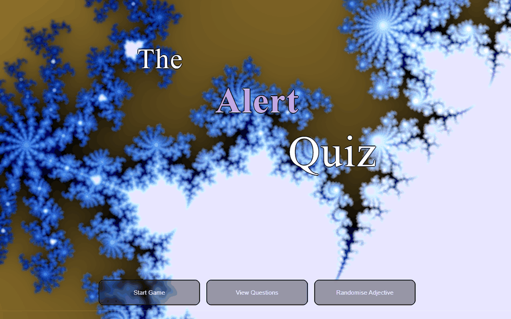
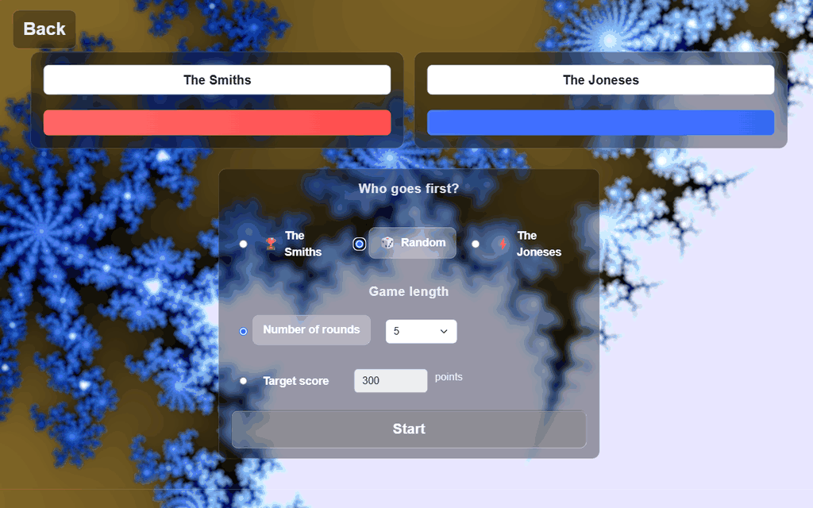
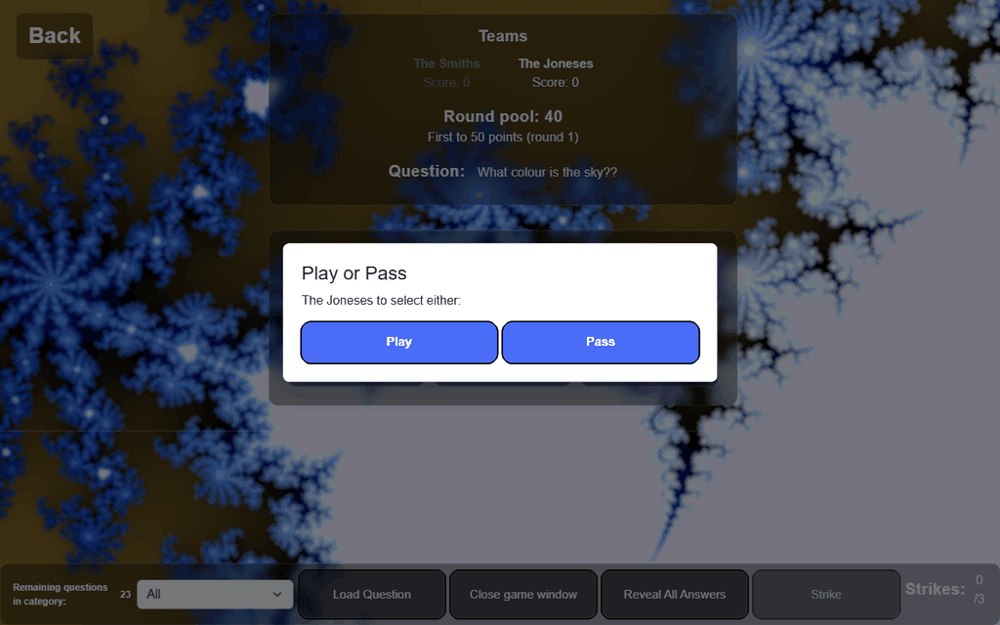
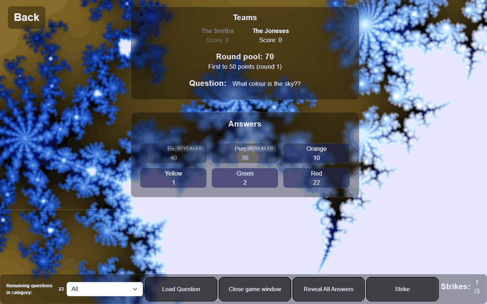
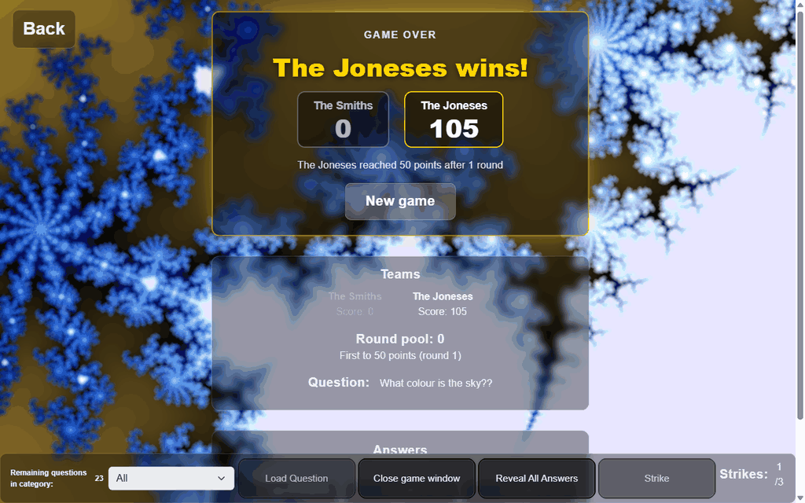
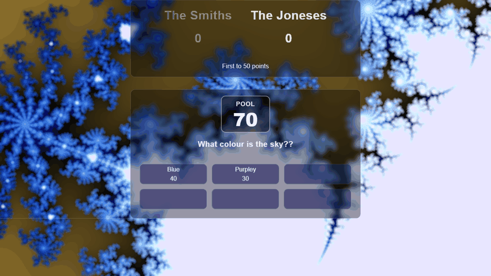
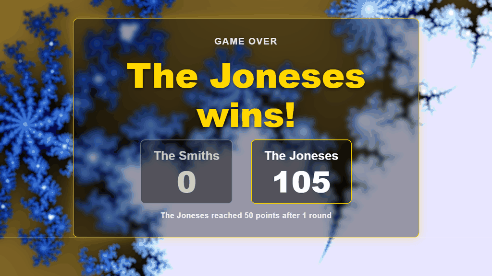
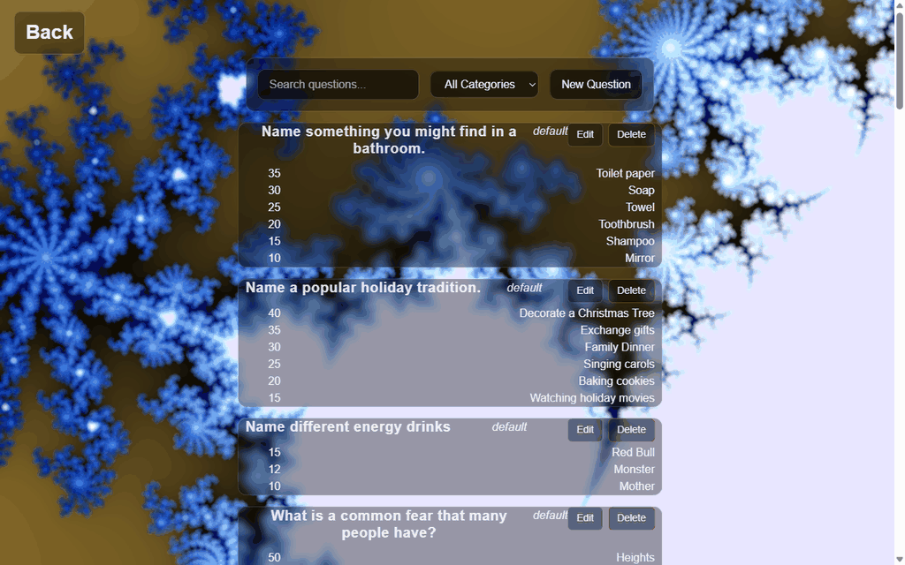
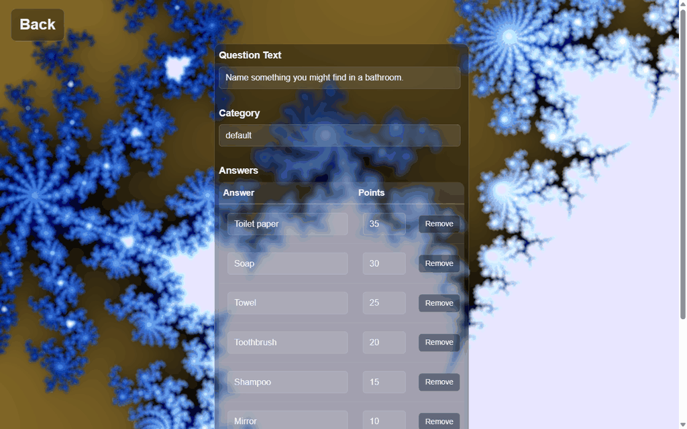

# Family Feud

A Family Feud style quiz game for two teams, built as a .NET 10 MAUI app that hosts a Blazor WebView. The host runs the game from one window and can open a second **Audience** window to show on a projector or TV. Questions and answers are stored in a Hasura GraphQL backend and can be managed from inside the app.



## Contents

- [How a game plays](#how-a-game-plays)
- [Setup](#setup)
- [Build and run](#build-and-run)
- [Host and audience windows](#host-and-audience-windows)
- [Managing questions](#managing-questions)

## How a game plays

### 1. Start a game

From the home screen, click **Start Game**. On the start screen:

- Type a name for each team.
- Under **Who goes first?**, pick a team or **Random**. The starting team then alternates for every question after the first.
- Under **Game length**, choose **Number of rounds** (5, 10, 15 or 20) or **Target score** (the first team to reach that many points wins; 1 to 10,000, 300 by default).
- Click **Start**.



### 2. Load a question

On the host board, optionally pick a category from the footer drop-down, then click **Load Question**. The question and its answers (with points) are shown to the host only. Clicking an answer reveals it on the audience display.

### 3. Face-off

Each question starts with a face-off. The starting team gives one answer first:

- If the host reveals the **top answer**, that team wins control straight away.
- Otherwise the other team gets one answer, and the team with the higher-scoring answer wins control. A tie is decided at random.
- If a team's answer isn't on the board, the host clicks **Strike** and the other team gets to answer. If both teams strike, the face-off starts again.

Every answer revealed in the face-off goes into the **round pool**.

### 4. Play or Pass

The team that wins the face-off decides whether to play the question or pass it to the other team. The host records the choice in the **Play or Pass** dialog.



### 5. Play the round

The team in control keeps guessing:

- **Correct answer:** the host clicks the answer to reveal it, and its points are added to the round pool. Team scores don't change until the round ends.
- **Wrong answer:** the host clicks **Strike**. The footer shows the count (for example `1 /3`).
- **Board cleared:** if every answer is revealed, the team in control wins the whole pool.



### 6. Steal

After **three strikes**, the other team gets **one** guess to steal:

- If they find an answer on the board, the host reveals it and the stealing team wins the pool **plus** that answer.
- If they miss, the host clicks **Strike** and the team in control keeps the pool.

When the round ends, the pool is added to the winning team's score and is reset. Answers can still be revealed for display (or use **Reveal All Answers**), but they no longer score. Load the next question to continue.

### 7. Winning

The game ends when the chosen number of rounds has been played, when a team reaches the target score, or when there are no questions left. The host board and the audience window then show a winning screen with the final scores. Click **New game** to return to the start screen.



## Setup

1. Install the [.NET 10 SDK](https://dotnet.microsoft.com/download) and the MAUI workload:

   ```
   dotnet workload install maui
   ```

   Alternatively, install Visual Studio with the **.NET Multi-platform App UI development** workload.

2. Copy `appsettings.example.json` to `appsettings.json` in the project folder:

   ```
   copy appsettings.example.json appsettings.json
   ```

3. Open `appsettings.json` and fill in your Hasura GraphQL endpoint and admin secret:

   ```json
   {
     "Hasura": {
       "Endpoint": "https://<your-project>.hasura.app/v1/graphql",
       "AdminSecret": "<your-hasura-admin-secret>"
     }
   }
   ```

   `appsettings.json` is git-ignored and is embedded into the app at build time. Never commit it or put the secret into source code.

## Build and run

Visual Studio is the easiest way: open `FamilyFeud.slnx`, choose the platform target from the debug drop-down and press F5.

From the command line, build or run one target framework at a time. On Windows:

```
dotnet build -f net10.0-windows10.0.19041.0
dotnet run -f net10.0-windows10.0.19041.0
```

Other target frameworks: `net10.0-android`, `net10.0-ios`, `net10.0-maccatalyst`.

## Host and audience windows

The app uses two windows that share the same game state:

- **Host window** (the main window): the host sees every answer and its points, and controls the game with **Load Question**, **Strike**, **Reveal All Answers** and the answer buttons.
- **Audience window**: click **Open game window** in the host board's footer to open it, then drag it onto the projector or TV screen and maximise it. It shows the team scores, the round pool, the question and only the answers that have been revealed. Click **Close game window** to close it.

Both windows update together as the host plays.





## Managing questions

Click **View Questions** on the home screen to open the Questions page. It lists every question with its category and answers, sorted by points.



- **Search and filter:** type in **Search questions...** or pick a category from the drop-down.
- **Create:** click **New Question**, then enter the **Question Text**, a **Category** and up to six answers with points (**+ Add Answer** adds a row, **Remove** deletes one). Click **Create Question** to save.
- **Edit:** click **Edit** on a question, change it, then click **Update Question**. **Cancel** goes back without saving.
- **Delete:** click **Delete** on a question (on the list or the edit page) and confirm. Deleting can't be undone.



All changes are saved straight to the Hasura backend.
